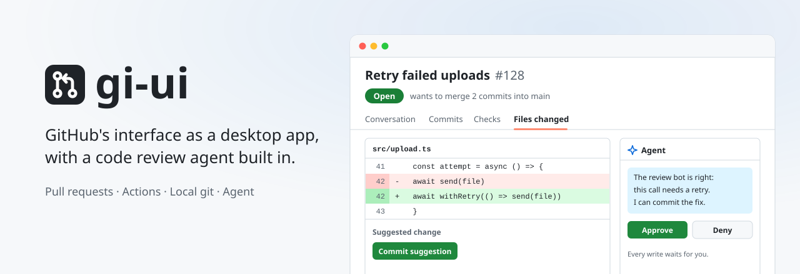

<p align="center">
  <picture>
    <source media="(prefers-color-scheme: dark)" srcset="docs/assets/cover-dark.svg" />
    
  </picture>
</p>

# gi-ui: a GitHub client with a built-in code review agent

[](LICENSE)

**GitHub's interface as a desktop app, signed in with just a token.** PRs, Actions, issues, releases and repository settings look and work like github.com, with GitHub Desktop-style local git and a Claude agent beside them.

## Why gi-ui

GitHub Desktop is good for local git, but PRs, Actions and most of the website are out of reach. gi-ui puts them all in one app.

- **Review.** Multi-line comments, suggestions you can commit, and pending reviews started anywhere.
- **Agent.** Reviews code, answers or fixes CodeRabbit and Greptile comments, and re-runs Actions. Every write waits for your approval.
- **Local git.** Clone, stage, commit, switch branches, pull and push.
- **Any sign-in.** PAT, GitHub CLI session, OAuth, or GitHub Enterprise.
- **Runs on your computer.** No server. Tokens are encrypted with your OS keychain, and the agent uses your own Anthropic key.

## Install

Download the macOS installer from [Releases](https://github.com/PlaygrndLabs/gi-ui/releases): `arm64` for Apple Silicon, `x64` for Intel. The app isn't notarized, so on first launch choose **Open Anyway** in System Settings → Privacy & Security.

## Run from source

```bash
npm install
npm run electron:dev
```

Sign in with a [personal access token](https://github.com/settings/tokens) and add your Anthropic key in Settings → Agent to use the agent.

To package the app, run `npm run electron:dist`. A web build for Cloudflare Workers is also available with `npm run cf:deploy`.

## More

[docs/GUIDE.md](docs/GUIDE.md) covers sign-in options, features, the agent, the Cloudflare setup, security and what's not covered yet.

## License

[MIT](LICENSE)
