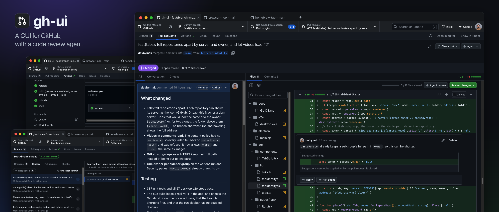

<p align="center">
  
</p>

# gh-ui: a GUI for GitHub, with a built-in code review agent

[](LICENSE)

**A simple desktop app with your branches, pull requests and Actions in the same window.** See every branch's local and GitHub state in one place, review pull requests as a chat beside the code, and follow Actions runs, with a Claude agent beside them. Sign in with just a token, or reuse your `gh` login.

## Why gh-ui

`gh` brings GitHub to your terminal. gh-ui brings it to an app, so you can read diffs, follow a failing run and review a change in one place, with an agent that can do the follow-up work.

- **Review.** Multi-line comments, suggestions you can commit, and pending reviews started anywhere.
- **Agent.** Reviews code, answers or fixes CodeRabbit and Greptile comments, and re-runs Actions. Every write waits for your approval.
- **Local and GitHub together.** One view of a branch: uncommitted files, commits only on your Mac, commits on GitHub, its pull request and its checks. Clone, stage, commit, stash, switch, pull and push.
- **One tab per repository.** Chrome-style tabs that keep each repository's view and Claude chat separate. Panes resize and collapse.
- **Any sign-in.** PAT, GitHub CLI session, OAuth, or GitHub Enterprise. Git uses the same sign-in for HTTPS clone, pull and push, so a token is enough.
- **Runs on your computer.** No server. Tokens are encrypted with your OS keychain, and the agent uses your own Anthropic key.

## Install

### macOS with Homebrew

This is the recommended option. Install [Homebrew](https://brew.sh/) first, then run:

```bash
brew tap PlaygrndLabs/tap
brew trust PlaygrndLabs/tap
brew install --cask gh-ui
```

Open **GitHub UI** from Applications or Spotlight. To update it later:

```bash
brew upgrade --cask gh-ui
```

### macOS direct download

Download `GitHub-UI-arm64.dmg` for Apple Silicon or `GitHub-UI-x64.dmg` for Intel from [Releases](https://github.com/PlaygrndLabs/gh-ui/releases). Open the disk image and move **GitHub UI** to Applications.

The app is not Apple-notarized. If macOS blocks the first launch, run:

```bash
xattr -dr com.apple.quarantine /Applications/gh-ui.app
```

## Run from source

```bash
npm install
npm run electron:dev
```

Sign in with **Continue with GitHub**, a [personal access token](https://github.com/settings/tokens) or your `gh` login, and add your Anthropic key in Settings → Agent to use the agent.

To package the app, run `npm run electron:dist`.

## More

[docs/GUIDE.md](docs/GUIDE.md) covers sign-in options, features, the agent, security and what's not covered yet.

## License

[MIT](LICENSE).
